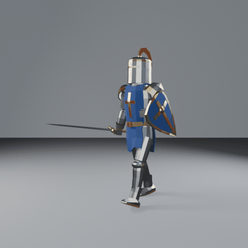

# Medieval Knight

Blender MCP와 AI 에이전트로 만든 로우폴리 중세 기사 캐릭터예요. 리깅과 제자리 걷기 애니메이션까지 들어 있어요.



## 파일

| 파일 | 내용 |
| --- | --- |
| `Knight.blend` | 원본 작업 파일 (모델, 리그 `Knight_Armature`, 액션 `Knight_Walk`) |
| `Knight.fbx` | Unity용 익스포트 (Humanoid 본 이름) |
| `Knight_Walk.gif` | 걷기 애니메이션 미리보기 (24프레임, 24fps) |
| `PROMPTS.md` | 모델링부터 리깅, 애니메이션, 수정까지 에이전트에 넣은 프롬프트 |
| `setup.ps1` | 새 PC용 환경 구축 스크립트 |

## 다른 컴퓨터에서 이어서 작업하기

준비물: Windows, [Blender](https://www.blender.org/download/), Git, Antigravity 또는 Claude Code

```powershell
git clone https://github.com/siru565/medieval-knight.git
cd medieval-knight
powershell -ExecutionPolicy Bypass -File .\setup.ps1
```

`setup.ps1`이 하는 일:
1. `uv`(uvx)가 없으면 설치
2. 가장 최신 Blender에 [blender-mcp](https://github.com/ahujasid/blender-mcp) 애드온을 설치하고 활성화
3. Antigravity(`~/.gemini/config/mcp_config.json`)와 Claude Code(`~/.claude.json`)에 `blender` MCP 서버 등록

설치가 끝나면:
1. Antigravity 또는 Claude Code를 재시작
2. Blender에서 `Knight.blend`를 열고, 3D 뷰포트에서 **N**을 누른 다음 **BlenderMCP** 탭에서 서버 켜기
3. 에이전트에게 이어서 작업을 지시 (`PROMPTS.md` 참고)

> MCP 클라이언트는 한 번에 하나만 Blender에 연결하세요. 여러 개를 연결하면 같은 포트를 두고 충돌해요.

## 작업 저장

```powershell
git add -A
git commit -m "작업 내용"
git push
```

다른 PC에서는 작업을 시작하기 전에 `git pull`을 먼저 하세요. `.blend`는 바이너리 파일이라 병합이 안 돼요. 두 PC에서 동시에 수정하지 마세요.
